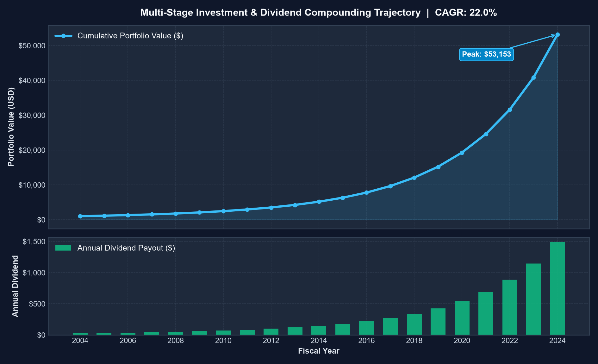

# Animated Financial & Dividend Growth Visualizer



A Python desktop analytics and time-series animation tool (`Matplotlib` + `Pandas` + `NumPy` + `Tkinter`) built to visualize multi-stage investment compounding, CAGR trajectories, and annual dividend cashflows.

## Key Features
- **Multi-Stage `FuncAnimation` Engine:** Animates equity compounding across distinct historical phases with automatic axis scaling and dividend milestone overlays.
- **2-Panel Executive Dashboard Export:** Generates dark-themed, high-DPI (`180 DPI`) equity + dividend bar chart snapshots (`--export-png`) for client reports and presentations.
- **Custom CSV Ingestion:** Load any custom `year,portfolio_value,annual_dividend` CSV via the desktop `Tkinter` interface or CLI (`--csv`).
- **Automated CAGR & Peak Annotation:** Computes Compound Annual Growth Rate (CAGR) and highlights peak equity milestones automatically.

## Quick Start
```bash
pip install matplotlib numpy pandas

# Launch interactive desktop GUI + live animation
python financial_visualizer.py

# Or render a high-DPI dashboard PNG from a CSV dataset via CLI
python financial_visualizer.py --csv sample_portfolio_growth.csv --export-png financial_demo_preview.png
```
